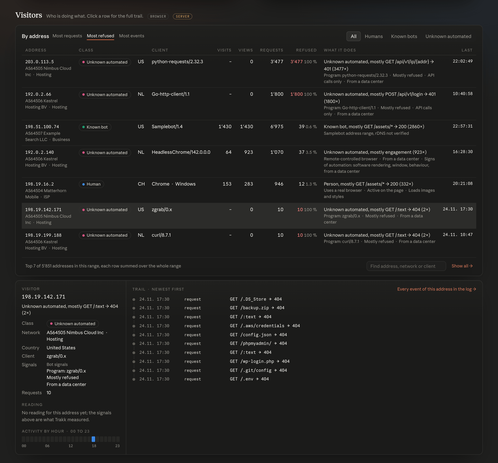

# nui

Self-hosted usage analytics that sees all of your incoming traffic, not only the part that runs JavaScript.

The name: *nui* is Hawaiian and Māori for "many", for all the data that comes in.

Most analytics tools are a browser script, so they only ever see visitors whose browser runs it. nui also takes a
feed from your backend and puts the two together: the people, and everything else that knocks on your door, from
crawlers and uptime probes to scanners and scripts walking your API.


- **The whole picture.** A small browser script reports page views, clicks, errors and web vitals; your backend
  reports every request it serves. Together they give a 360° view of what reaches your product.
- **Who is doing what.** Every address with its network, country and client, and the trail of what it did. Nothing
  is sampled and nothing leaves your server.
- **People or bots.** Each visitor is classed as a person, a known bot, an uptime probe or unknown automation, and
  the dashboard shows the reasons. Known bots come from the [ipverse](https://github.com/ipverse) lists.
- **AI that reads the traffic for you.** With a model key nui writes a short briefing of what changed and says in a
  sentence what an address is up to. Every figure is computed without it; the model never produces a number.
- **Harmless to your site.** The script is under 6 kB gzipped, sends in the background, and caps and backs off on its
  own. If nui is down, your pages and your backend do not notice.
- **One container.** A single image behind your reverse proxy, with its database inside and sign-in by OIDC or an
  admin token: `docker compose up -d`.



Both screenshots show simulated traffic.

## Development

```sh
cd ui && npm install
npm run dev        # http://127.0.0.1:5173, /api proxied to the Go server on :8080
npm test           # unit tests (vitest)
make check         # the full gate (ship), from the repo root
```

The Go server embeds the built UI: `npm run build` in `ui/`, then in `backend/`:

```sh
mkdir -p data && cp ../docs/sites.example.json data/sites.json
BACKEND_DATA_DIR=./data BACKEND_AUTH_DISABLED=true BACKEND_REFDATA_DISABLED=true go run ./cmd/server -demo 30
```

and open <http://localhost:8080/dashboard/>. `-demo 30` fills an empty database with 30 days of simulated traffic
on the configured sites.

### Simulated traffic

`make sim` runs the UI against a simulated world: the real server on a temporary data directory, sign-in off, a
seeded history backfilled through the real collector and classifier, then advancing live each time the dashboard
asks; Vite's dev server proxies to it and Ctrl-C stops both. `make sim-server` is the server alone, for curl or a
second UI. The knobs, each falling back to its default with a warning when it does not parse:

| Knob | Default | |
|---|---|---|
| `NUI_SIM_SEED` | 1 | the world: the same seed and start give the same world |
| `NUI_SIM_SCALE` | 1 | volume; 1 is about 25 visitors a day per site, at most 50 |
| `NUI_SIM_SPEED` | 1 | simulated time per wall time, live, at most 3600; a tick hands out at most an hour of it |
| `NUI_SIM_DAYS` | 30 | history before the start |
| `NUI_SIM_START` | now | the start, RFC 3339 |
| `NUI_SIM_PORT` | 8080 | the server's loopback port (the UI proxies there) |
| `NUI_SIM_SCENARIOS` | the default set | comma-separated, `all` for every one (`sim scenarios` below) |
| `NUI_SIM_CLASSIFY` | true | run the classifier over the history |
| `NUI_SIM_FEED_OUTAGE` | off | minutes the lookup site's feed is down, from a minute after the start |
| `NUI_SIM_FLOOD` | off | `addr`, `64` or `48`: a ten-minute flood from one address, a /64 or a /48 |
| `NUI_SIM_LATE_FEED` | off | minutes after the start until the blog's feed first delivers (0: at the start), or `never` |
| `NUI_SIM_SLOW_MS` | 0 | every dashboard answer waits this long |
| `NUI_SIM_EMPTY_SITE` | false | one more site, configured, that never delivers |

The simulator (`backend/internal/sim`) has a command line of its own, `go run ./cmd/server sim <command>` in
`backend/`, the knobs as above and flags over them (`-h`):

- `scenarios` lists the scenarios, their windows and what the dashboard shows for each; `check` plays each on its
  own and checks exactly that.
- `backfill -data ./data` writes a history into a data directory (and `sites.json` and the world's reference data
  into `ref/` when missing: run the server on it with `BACKEND_REFDATA_DISABLED=true`). About 25,000 events a second.
  The largest run is scale 50: about 110,000 events a simulated day, some 5 s of backfill each, and up to 140 MB of
  day plans in memory (a plan holds a whole day's requests).
- `live -target http://127.0.0.1:8080 [-rate 50] [-speed 60] [-for 10m] [-key domain=key]` sends tracker and feed
  batches to a running server, backing off on 429 as the tracker does. `-rate` sets the scale for that many events a
  second, averaged over a simulated week (the day's rhythm and the weekend vary it; at speed 1 at most about 1, raise
  `-speed` for more). Each browser's address goes in
  `X-Forwarded-For`, which nui reads with one trusted hop: target the server itself, `server -sim` (it sets
  `BACKEND_TRUSTED_HOPS=1` whatever the environment says) or one left at the default; at 0 every visitor is the
  loopback. Without `-key` the feeds use the simulator's own keys, which a `make sim-server` of the same seed has
  configured.
- `export -out DIR` writes the dashboard API's answers over a seeded history ending at the UI fixtures' "now", one
  JSON file per request the UI's fixture mode makes, named in `DIR/index.json`.

Every address is a documentation address (RFC 5737, 2544, 3849). Real reference data knows none of them, so the
simulator brings its own (made-up networks, their countries, three made-up bots) wherever it backfills; with a real
bot list loaded, its crawlers and probe take a real service's ranges from it. In a Go test,
`sim.History(ctx, st, sim.HistoryOptions{...})` backfills a seeded history; its world's `Expectations()` are the
scenarios' checks, which `simcli.Check` runs against the dashboard.

## Running it

`compose.yaml` runs the released image behind an existing Traefik. A deployment is three files in one directory:
`compose.yaml`, `.env` and `data/sites.json`. The dashboard is at `https://<PUBLIC_FQDN>/dashboard/`; the bare host
answers 404 like any unknown path and does not lead there.

```sh
curl -fsSLO https://raw.githubusercontent.com/trick77/nui/master/compose.yaml
printf 'PUBLIC_FQDN=nui.example.com\nBACKEND_ADMIN_TOKEN=%s\n' "$(openssl rand -hex 32)" > .env
mkdir -p data
curl -fsSL -o data/sites.json https://raw.githubusercontent.com/trick77/nui/master/docs/sites.example.json
# edit .env: your host name; edit data/sites.json: your domains (next section)
sudo chown -R 65532:65532 data
docker compose pull && docker compose up -d
```

`.env` holds only what differs from the defaults: the host name (`PUBLIC_FQDN`) and a sign-in method, the admin
token above, the OIDC client (`BACKEND_OIDC_ISSUER`, `_CLIENT_ID`, `_CLIENT_SECRET`, optionally `_ADMIN_GROUP`), or
both (next section). Optionally `LLMWIRE_MIMO_API_KEY` adds the model's briefing and readings. Everything else has a
default that suits the compose file. [`.env.example`](.env.example) is the complete list: every variable, its
default and what it does; copy a line from there into `.env` only to change it.

### Sign-in

The dashboard signs in with OIDC (`BACKEND_OIDC_*`), with an admin token (`BACKEND_ADMIN_TOKEN`, 32 to 2048 bytes,
`openssl rand -hex 32`), or with either: the sign-in card offers what is configured. With `PUBLIC_FQDN` set nui
refuses to start with neither. The token is the way in when the identity provider is down; its session is named
`admin`. The session cookie is signed with a key derived from a session secret together with the token: changing
either signs everyone out. The secret is `BACKEND_SESSION_SECRET`, or, left empty, one nui makes at first start and
keeps in `data/session.secret` (owner-only; a data directory nui cannot write stops the start). Token attempts are
spaced a second apart per address or IPv6 /64, half a second per IPv4 /24 or IPv6 /48 and a quarter of a second
across all callers: at most 4 guesses a second in all. Past a short queue they get a 429 with `Retry-After`.

nui reads the caller's address from `X-Forwarded-For` as many entries from the right as there are proxies in front
of it (`BACKEND_TRUSTED_HOPS`, 1 for the compose file's Traefik). Reached without a proxy (a published port, a local
run), set it to 0: the caller could otherwise write its own address into the header.

### Sites

nui only stores events for the sites listed in `data/sites.json` (the container's `/data/sites.json`; shape in
[docs/sites.example.json](docs/sites.example.json)): domain, product, path rules that group raw paths into
templates, and for a server feed the SHA-256 of its key. The file is read at start: restart nui after changing it.
Without it nui still starts, logs `Sites file missing`, refuses every event (403) and the dashboard lists no domain;
with it, the start log names the loaded domains (`Sites loaded`).

A site without a server feed leaves `feed_key_sha256` empty. For one with a feed, create a key and its hash with

```sh
docker compose run --rm nui -new-feed-key
```

The key goes to the product's feed emitter (`Authorization: Bearer <key>` on `POST /api/feed`), the hash into
`sites.json`.

### Browser script

Adding a product, script and feed: [INTEGRATION.md](INTEGRATION.md). On a page, include the script:

```html
<script src="https://nui.example.com/nui.js" defer></script>
```

It posts batches to `POST /api/in` and keeps every batch within the collector's limits on its own; a batch over
one is refused whole (413, or 400 for a malformed one) and its events are lost. For anyone sending there
otherwise, the limits are:

| What | Limit |
|---|---|
| Body | 32 KiB, 50 events |
| `url`, `ref`, `src`, `href` values; an event's `url` | 2048 bytes |
| Every other string, `title`, `n`, `vid`, `sid` | 512 bytes |
| An event's `p` | 4 KiB as sent; maps 64 keys of at most 64 bytes, arrays 50 items, 8 levels |
| `ctx` without `url` and `ref`, as stored | 4 KiB |
| An event's own row, as stored | 16 KiB (the batch's context and headers aside) |
| A batch's rows, as stored | 64 KiB |

"As stored" counts the event's columns, its `url` with its path, a page view's referrer and the props re-encoded
(U+2028 and U+2029 take six bytes each); the request's client-hint and fetch headers are kept up to 2 KiB, on the
batch's first row. The rate is 60 events a minute per address or IPv6 /64 and 600 per /48 (IPv4 /24), with a burst
of 60; a batch is charged one event per event or per 2 KiB stored, whichever is more, and every request pays one on
arrival (429 with `Retry-After` beyond it). `Retry-After` covers the retry: the same batch sent again after it
passes, its arrival token included, unless other requests from the address spent the tokens meanwhile. A body not
received within 10 s is a 408: send it again.

### Server feed

`POST /api/feed` takes `{"v": 1, "site": "<domain>", "events": [...]}` as JSON, at most 256 KiB and 500 events per
batch, rate-limited per key (200 events a second, a burst of 5000): a batch is charged one per event it stores and
passes while the key has a token left, running it into debt; a key without one is refused before its body is read.
`Retry-After` covers the retry: the same batch sent again after it passes. The batch as a whole is refused only for an unparseable envelope (400), a wrong key
(401), another site's name (400), its size or event count (413), a body not received within 30 s (408) or the rate
(429). One event's content never refuses the batch: strings over their limit are clipped (on a character boundary),
and an event that is no JSON object, has a field of the wrong type, lacks a parseable `ip` or has an impossible
`status` (outside 0-999), `dur_ms` or `bytes` (negative) is dropped and counted as rejected in the dashboard's
footer, the rest is stored. A request with a wrong key names no site nui can trust: it is counted collector-wide,
with the unknown domains every footer shows.

| Field | Limit (bytes) |
|---|---|
| `method` | 16 |
| `sf_site`, `sf_mode`, `sf_dest` | 32 |
| `account` | 128 |
| `route` | 200 |
| `ua`, `lang`, `ch_ua` | 512 |
| `path`, `ref` | 2048 (query and fragment dropped) |
| `ip` | an IPv4 or IPv6 address; a zone (`%eth0`) is dropped |

Send only these fields, never raw request headers: they can carry credentials. A refused batch (408, 429, 5xx)
can be sent again; 400, 401 and 413 will be refused again. Events an accepted batch dropped are counted as
rejected once; a batch refused for the rate is not counted until it is taken.

### Dashboard API

`/api/dash/*` is the dashboard's own API (a session required). For links into it: the log's `addr` filter takes an
address or an IPv6 /64 (any other prefix is a 400), its `asn` filter an AS number.

## License

MIT
