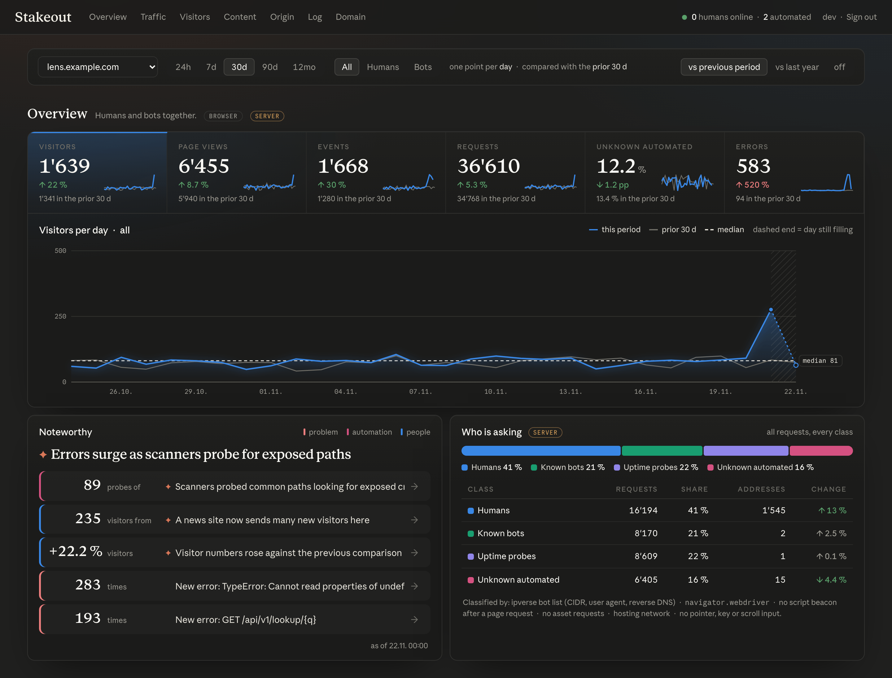

# Trakk

Self-hosted web traffic observability: all of your incoming traffic, not only the part that runs JavaScript.

Trakk shows who and what reaches your product and what it does there: the people, and everything else that knocks on
your door, from crawlers and uptime probes to scanners and scripts walking your API. It puts a browser script and a
feed from your backend together, where a script alone only ever sees visitors whose browser runs it. No funnels, no
goals, no conversion reports: it watches the traffic. Where other tools bolt a chat box onto their charts, the model in
Trakk is part of the analysis: it works from what Trakk has already worked out and never makes up a figure.



- **The whole picture.** A small browser script reports page views, clicks, errors and web vitals; your backend
  reports every request it serves. Together they give a 360° view of what reaches your product.
- **Who is doing what.** Every address with its network, country and client, and the trail of what it did. Nothing
  is sampled and nothing leaves your server.
- **People or bots.** Each visitor is classed as a person, an API client your backend signed in, a known bot, an uptime
  probe or unknown automation, and the dashboard shows the reasons. Known bots come from the
  [ipverse](https://github.com/ipverse) lists.
- **AI built in, not bolted on.** The model is part of the analysis, not a chat box on top of the charts: it works from
  the facts and verdicts Trakk has already computed, writes a short briefing of what changed and says in a sentence
  what an address is up to. Every figure is computed without it; the model never produces a number.
- **Harmless to your site.** The script is under 6 kB gzipped, sends in the background, and caps and backs off on its
  own. If Trakk is down, your pages and your backend do not notice.
- **One container.** A single image behind your reverse proxy, with its database inside and sign-in by OIDC or an
  admin token: `docker compose up -d`.


Both screenshots show simulated traffic, without a model.

## Plugins

Ready-made integrations, script and server feed in one:

- **WordPress**: [trakk-wordpress](https://github.com/trick77/trakk-wordpress#setup). Its setup starts here, with the
  domain and a feed key in [`sites.json`](#sites).

To build one for anything else: [INTEGRATION.md](INTEGRATION.md).

## Development

```sh
cd ui && npm install
npm run dev        # http://127.0.0.1:5173, /api proxied to the Go server on :8080
npm test           # unit tests (vitest)
make check         # the full gate (ship), from the repo root
```

The Go server embeds the built UI: `npm run build` in `ui/`, then in `backend/`:

```sh
mkdir -p data conf && cp ../docs/sites.example.json conf/sites.json
BACKEND_DATA_DIR=./data BACKEND_CONF_DIR=./conf BACKEND_AUTH_DISABLED=true BACKEND_REFDATA_DISABLED=true \
  BACKEND_TRUSTED_HOPS=0 go run ./cmd/server -demo 30
```

and open <http://localhost:8080/dashboard/>. `-demo 30` fills an empty database with 30 days of simulated traffic
on the configured sites and marks the directory as the simulator's (`sim.json`): a later `-demo` start serves
it as it is, a database with events the simulator did not write is refused. `-demo` and `-sim` are development
only: never together, never with `PUBLIC_FQDN` set.

### Simulated traffic

`make sim` runs the UI against a simulated world: the real server on a temporary data directory, sign-in off, a
seeded history backfilled through the real collector and classifier, then advancing live each time the dashboard
asks; Vite's dev server starts once that server answers on its port (a port in use stops `make sim` with a message)
and proxies to it, and Ctrl-C stops both. `make sim-server` is the server alone, for curl or a second UI. Its
alerts come from a generated `notify.json` with a rule of every group, stepped through the history's last six days
on its clock; a recording channel takes every message, nothing is sent. The knobs, each falling back to its default
with a warning when it does not parse:

| Knob | Default | |
|---|---|---|
| `BACKEND_SIM_SEED` | 1 | the world: the same seed and start give the same world |
| `BACKEND_SIM_SCALE` | 1 | volume; 1 is about 25 visitors a day per site, at most 50 |
| `BACKEND_SIM_SPEED` | 1 | simulated time per wall time, live, at most 3600; a tick hands out at most an hour of it |
| `BACKEND_SIM_DAYS` | 30 | history before the start |
| `BACKEND_SIM_START` | now | the start, RFC 3339: the history ends there, and live time runs on from it once the server serves |
| `BACKEND_SIM_PORT` | 8080 | the server's loopback port (the UI proxies there) |
| `BACKEND_SIM_SCENARIOS` | the default set | comma-separated, `all` for every one (`sim scenarios` below) |
| `BACKEND_SIM_CLASSIFY` | true | run the classifier over the history |
| `BACKEND_SIM_FEED_OUTAGE` | off | minutes the lookup site's feed is down, from a minute after the start |
| `BACKEND_SIM_FLOOD` | off | `addr`, `64` or `48`: a ten-minute flood from one address, a /64 or a /48 |
| `BACKEND_SIM_LATE_FEED` | off | minutes after the start until the blog's feed first delivers (0: at the start), or `never` |
| `BACKEND_SIM_SLOW_MS` | 0 | every dashboard answer waits this long |
| `BACKEND_SIM_EMPTY_SITE` | false | one more site, configured, that never delivers |

The simulator (`backend/internal/sim`) has a command line of its own, `go run ./cmd/server sim <command>` in
`backend/`, the knobs as above and flags over them (`-h`):

- `scenarios` lists the scenarios, their windows and what the dashboard shows for each; `check` plays each on its
  own and checks exactly that. The watch's (`path-flip`, `scanner-hit`, `post-target`, `script-inject`, `soft-404`)
  need nine days of history: its learning window is a week.
- `backfill -data ./data [-wipe]` writes a history, `sites.json` and the world's reference data (`ref/`) into an
  empty or absent data directory, or one it wrote before (marked by `sim.json`; a second history is refused,
  `-wipe` empties the directory first). Anything else is refused untouched, and so is every run with `PUBLIC_FQDN`
  set. Serve it with `server -demo 1`, `BACKEND_REFDATA_DISABLED=true` and `BACKEND_CONF_DIR` set to the same
  directory (its `sites.json`). About 25,000 events a second.
  The largest run is scale 50: about 110,000 events a simulated day, some 5 s of backfill each, and with the default
  scenarios up to about 210 MB of day plans in memory (a plan holds a whole day's requests; the day before is kept
  beside it only for the three hours past midnight a visit begun on it can last, the referrer wave's day and the one
  before it the largest pair), live as long as it runs: `growth` rises up to the start and keeps its level after.
- `live -target http://127.0.0.1:8080 [-rate 50] [-speed 120] [-for 10m] [-key domain=key]` sends tracker and feed
  batches to a running server, backing off on 429 as the tracker does and retrying a batch without an answer or with
  a 5xx after a growing wait. It stops with an error when the server fails everything for 30 s or refuses a site's
  batches for good (401: a wrong `-key`, 403: a site its sites file lacks). `-rate` sets the scale for that many
  events a second, averaged over a simulated week (the day's rhythm and the weekend vary it; at speed 1 at most about
  1, raise `-speed` for more). Each browser's address goes in `X-Forwarded-For`, which Trakk reads with one trusted
  hop: target the server itself, `server -sim` (it sets `BACKEND_TRUSTED_HOPS=1` whatever the environment says) or
  one left at the default; at 0 every visitor is the loopback. Without `-key` the feeds use the simulator's own keys,
  which a `make sim-server` of the same seed has configured.
- `export -out DIR` writes the dashboard API's answers over a seeded history ending at the UI fixtures' "now", one
  JSON file per request the UI's fixture mode makes, named in `DIR/index.json`.

Every address is a documentation address (RFC 5737, 2544, 3849). Real reference data knows none of them, so the
simulator brings its own (made-up networks, their countries, three made-up bots) wherever it backfills; with a real
bot list loaded, its crawlers and probe take a real service's ranges from it. Its reference data is marked
(`ref/sim-ref.json`) and only its modes (`-sim`, `-demo`) use it, without rDNS verification of the bots; a
normal start discards it and fetches the real data, always verifies, warns loudly in a directory the simulator
wrote and refuses one with `PUBLIC_FQDN` set. In a Go test, `sim.History(ctx, st, sim.HistoryOptions{...})`
backfills a seeded history; its world's `Expectations()` are the scenarios' checks, which `simcli.Check` runs
against the dashboard.

## Running it

`compose.yaml` runs the released image behind an existing Traefik. A deployment is three files in one directory:
`compose.yaml`, `.env` and `conf/sites.json`. `data/` is what Trakk writes (the database, the reference data cache,
the session secret), `conf/` what you write, mounted read-only. The dashboard is at
`https://<PUBLIC_FQDN>/dashboard/`; the bare host answers 404 like any unknown path and does not lead there.

```sh
curl -fsSLO https://raw.githubusercontent.com/trick77/trakk/master/compose.yaml
printf 'PUBLIC_FQDN=trakk.example.com\nBACKEND_ADMIN_TOKEN=%s\n' "$(openssl rand -hex 32)" > .env
mkdir -p data conf
curl -fsSL -o conf/sites.json https://raw.githubusercontent.com/trick77/trakk/master/docs/sites.example.json
# edit .env: your host name; edit conf/sites.json: your domains (next section)
sudo chown -R 65532:65532 data conf
docker compose pull && docker compose up -d --remove-orphans
```

A deployment from before `conf/` keeps its `data/sites.json`: Trakk reads it while `conf/sites.json` is missing and
warns at every start. Move it: `mkdir -p conf && mv data/sites.json conf/`, update `compose.yaml` (it mounts
`./conf`), then `sudo chown -R 65532:65532 conf`.

`.env` holds only what differs from the defaults: the host name (`PUBLIC_FQDN`) and a sign-in method, the admin
token above, the OIDC client (`BACKEND_OIDC_ISSUER`, `_CLIENT_ID`, `_CLIENT_SECRET`, optionally `_ADMIN_GROUP`), or
both (next section). Optionally `LLMWIRE_MIMO_API_KEY` adds the model's briefing and readings. Everything else has a
default that suits the compose file. [`.env.example`](.env.example) is the complete list: every variable, its
default and what it does; copy a line from there into `.env` only to change it.

### Sign-in

The dashboard signs in with OIDC (`BACKEND_OIDC_*`), with an admin token (`BACKEND_ADMIN_TOKEN`, 32 to 2048 bytes,
`openssl rand -hex 32`), or with either: the sign-in card offers what is configured. With `PUBLIC_FQDN` set Trakk
refuses to start with neither. The token is the way in when the identity provider is down; its session is named
`admin`. The session cookie is signed with a key derived from a session secret together with the token: changing
either signs everyone out. The secret is `BACKEND_SESSION_SECRET`, or, left empty, one Trakk makes at first start and
keeps in `data/session.secret` (owner-only; a data directory Trakk cannot write stops the start). Token attempts are
spaced a second apart per address or IPv6 /64, half a second per IPv4 /24 or IPv6 /48 and a quarter of a second
across all callers: at most 4 guesses a second in all. Past a short queue they get a 429 with `Retry-After`.

Trakk reads the caller's address from `X-Forwarded-For` as many entries from the right as there are proxies in front
of it (`BACKEND_TRUSTED_HOPS`, 1 for the compose file's Traefik). Reached without a proxy (a published port, a local
run), set it to 0: the caller could otherwise write its own address into the header.

### Sites

Trakk only stores events for the sites listed in `conf/sites.json` (the container's `/conf/sites.json`; shape in
[docs/sites.example.json](docs/sites.example.json)): domain, product, path rules that group raw paths into
templates, for a server feed the SHA-256 of its key, and its kind: `site`, or `api` for a domain with a feed and no
pages, shown by its calls (endpoints, accounts, failures, durations) instead of its visits. An optional `order` (1, 2,
…) sets the domain's place among its product's in the menu; domains without one follow, by name. The menu's first
domain is the one the dashboard opens with, unless the browser remembers another. The file is read at start: restart
Trakk after changing it. A Trakk older than a field refuses the file: update first, then add it.
Without it Trakk still starts, logs `Sites file missing`, refuses every event (403) and the dashboard lists no
domain; with it, the start log names the loaded domains (`Sites loaded`).

A site without a server feed leaves `feed_key_sha256` empty. For one with a feed, create a key and its hash with

```sh
docker compose run --rm trakk -new-feed-key
```

The key goes to the product's feed emitter (`Authorization: Bearer <key>` on `POST /api/feed`), the hash into
`sites.json`.

### Browser script

Adding a product, script and feed: [INTEGRATION.md](INTEGRATION.md), or a [plugin](#plugins). On a page, include the
script:

```html
<script src="https://trakk.example.com/trakk.js" defer></script>
```

It posts batches to `POST /api/in` and keeps every batch within the collector's limits on its own; a batch over
one is refused whole (413, or 400 for a malformed one) and its events are lost. For anyone sending there
otherwise, the limits are:

| What | Limit |
|---|---|
| Body | 32 KiB, 50 events |
| `url`, `ref`, `src`, `href` values; an event's `url` | 2048 bytes |
| Every other string, `title`, `n`, `vid`, `sid` | 512 bytes |
| An event's `p` | 4 KiB as sent; maps 64 keys of at most 64 bytes, arrays 50 items, 8 levels |
| `ctx` without `url` and `ref`, as stored | 4 KiB |
| An event's own row, as stored | 16 KiB (the batch's context and headers aside) |
| A batch's rows, as stored | 64 KiB |

"As stored" counts the event's columns, its `url` with its path, a page view's referrer and the props re-encoded
(U+2028 and U+2029 take six bytes each); the request's client-hint, fetch, `Origin` and `Signature-Agent` headers
are kept up to 2 KiB, on the batch's first row. The rate is 60 events a minute per address or IPv6 /64 and 600 per
/48 (IPv4 /24), with a burst of 60; a batch is charged one event per event or per 2 KiB stored, whichever is more, and every request pays one on
arrival (429 with `Retry-After` beyond it). `Retry-After` covers the retry: the same batch sent again after it
passes, its arrival token included, unless other requests from the address spent the tokens meanwhile. A body not
received within 10 s is a 408: send it again.

### Server feed

`POST /api/feed` takes `{"v": 1, "site": "<domain>", "events": [...]}` as JSON, at most 256 KiB and 500 events per
batch, rate-limited per key (200 events a second, a burst of 5000): a batch is charged one per event it stores and
passes while the key has a token left, running it into debt; a key without one is refused before its body is read.
`Retry-After` covers the retry: the same batch sent again after it passes. The batch as a whole is refused only for an unparseable envelope (400), a wrong key
(401), another site's name (400), its size or event count (413), a body not received within 30 s (408) or the rate
(429). One event's content never refuses the batch: strings over their limit are clipped (on a character boundary),
and an event that is no JSON object, has a field of the wrong type, lacks a parseable `ip` or has an impossible
`status` (outside 0-999), `dur_ms` or `bytes` (negative) is dropped and counted as rejected in the dashboard's
footer, the rest is stored. A request with a wrong key names no site Trakk can trust: it is counted collector-wide,
with the unknown domains every footer shows.

| Field | Limit (bytes) |
|---|---|
| `method` | 16 |
| `sf_site`, `sf_mode`, `sf_dest` | 32 |
| `op`, `err` | 64 |
| `account` | 128 |
| `route` | 200 |
| `sig_agent` | 256 |
| `ua`, `lang`, `ch_ua` | 512 |
| `path`, `ref` | 2048 (query and fragment dropped) |
| `ip` | an IPv4 or IPv6 address; a zone (`%eth0`) is dropped |

Send only these fields, never raw request headers: they can carry credentials. A refused batch (408, 429, 5xx)
can be sent again; 400, 401 and 413 will be refused again. Events an accepted batch dropped are counted as
rejected once; a batch refused for the rate is not counted until it is taken.

### Storage

Raw events, every request with its address, user agent and path, are kept `BACKEND_RAW_RETENTION_DAYS` (90, at
least 15: 7d and its prior period are read raw): the log, a visitor's trail and what an address does reach back that
far. The figures (tiles, lists, hours, the year before) are built per UTC day two days after it ended and kept; a
day's raw is deleted only once its figures are built from it. Each address's daily sums, the actor classes and the
model's usage are kept `BACKEND_RETENTION_MONTHS` (25). `BACKEND_MAX_DB_MB` caps the whole
([`.env.example`](.env.example)).

The watch (a path refused for days that suddenly answers, a scanner answered where nobody was before, a new target,
a new host the pages load scripts from, once addresses of three networks reported it on one day: a visitor id is the
browser's word, an IPv4 /24 or an IPv6 /48 one network) judges each day against a small state per site, walked from
raw a closed day at a time and kept past it: a template or host goes `BACKEND_RETENTION_MONTHS` after its last
request, never by the size cap (at most 20,000 templates and 500 hosts a site, a host few networks report the first
to make room). A day makes at most ten findings of a kind, the hosts most networks report first; the rest are found
on a later day, at their own time. After an upgrade it walks every day with raw first
and finds nothing in them; a site's first week finds nothing either, everything is new then. Today's findings are
provisional: judged on the day so far, they may go again, and the briefing waits until their day closes.

A release that first deletes raw by days deletes nothing for 7 days after its first start, a restart included; the
footer says from when. Then raw from the day holding the months' cutoff back goes at once, the rest down to the raw
days a day at a time in short steps, and the database file shrinks a MiB at a time (incremental vacuum, the mode
Trakk creates its database in), at most 30 s per retention round, without locking the collector out.

### Notifications

Trakk records alerts from rules: what Noteworthy finds, a source gone silent, the collector refusing events, its own
jobs failing, a figure leaving its usual level. The dashboard lists them (`GET /api/dash/alerts`); channels in
`conf/notify.json` get them as messages. The file holds the channels' tokens: `chmod 600 conf/notify.json`, owned by
65532 like the rest of `conf/`. Shape in [docs/notify.example.json](docs/notify.example.json):

- `channels`: a name for each service URL (shoutrrr's format: `ntfy://`, `smtp://`, `gotify://`, …), or
  `{"url": …, "min_severity": "high", "max_per_hour": 4}`. A channel gets only alerts at or above its
  `min_severity` (default `low`), at most `max_per_hour` messages (default 10; the rest waits), one message per
  step bundling what is due. The dashboard shows a channel's name and service, its last delivery and last error,
  never its URL.
- `defaults`: `channels`, `cooldown` (default `1h`) and `severity` (`low`, `normal`, `high`; default `normal`) for
  every rule that does not set its own.
- `rules`: each has a unique `name` (its identity: rename one and it starts anew), `on` (a trigger below), the
  common `enabled`, `sites` and `products` (both left out: every site; a domain or product the sites file lacks is a
  fault), `channels` (`[]`: recorded only), `cooldown`, `severity`, and for the states (source, collector, instance,
  level) `for` (how long it holds before it is reported) and `repeat` (a reminder while it lasts; default never).

| `on` | Parameters (default) |
|---|---|
| `error.new`, `failure.new`, `probe.new`, `endpoint.new`, `referrer.new` | `min` (1, 3, 3, 5, 2) |
| `spike.addr`, `spike.net` | `min` requests (100, 200), `share` % of all (25, 40), `factor` over the 24 h before (3) |
| `trend.visitors`, `trend.calls`, `trend.failed`, `trend.auto_share` | `min` (20 visitors, 100 calls, 100 calls in both periods; none for `auto_share`), `change` (20 %, 20 %, 5 pp, 5 pp), `direction` (`up`, `down`, `both`) |
| `source.silent` | `after` (required), `source` (`browser`, `server`; both) |
| `collector.refused`, `collector.dropped`, `collector.unknown_domain` | `min` (1), `window` (`1h`, counted by the whole hour) |
| `job.failed` | `jobs`: `agg`, `retention`, `purge`, `refdata`, `classify`, `writer` (all) |
| `db.size_cap`, `llm.budget` | none |
| `level.requests`, `level.visitors`, `level.failed` (% of an API's calls), `level.p95` (an API's ms) | `window` (required, at most `24h`) and one or more of `min`, `max`, `factor`, `drop` (%), all of them together; `baseline` (`days`: the 7 days before, `weekday`: that weekday of the 4 weeks before), `floor` (20), `calls` (100, `level.failed` only) |

The traffic triggers are Noteworthy's findings over the last 24 hours against the 24 before, checked when an hour
closes; the others every five minutes. Each key is reported when it enters the set (a new error, a spiking
address) and closed in silence when it leaves; a state is reported when it opens and when it clears. A key back
within `cooldown` of leaving stays quiet. A rule's first pass, a changed threshold under the same name and a pass
after six hours without one record what is there without sending it. A level's `factor` and `drop` compare with
the median of the same window at the same time of day; with fewer than 3 days to compare it judges nothing, and
without `min` or `max` a usual level below `floor` is no alert. After a downtime nothing older than six hours is
sent.

Switching off: `"enabled": false` on a rule (its history stays) or at the top of the file (alerts are recorded,
nothing is sent). Without the file, or with no rule, Trakk records one rule per trigger that needs no parameter and
sends nothing. A file with a fault never stops Trakk: it starts, records with those default rules, sends nothing,
logs every fault and the footer lists them. The file is read at start: restart Trakk after changing it, and check
it first:

```sh
docker compose run --rm trakk -notify-check   # every fault, exit 1 on any; sends nothing
docker compose run --rm trakk -notify-test    # a test message to every channel, each one's outcome
```

### Dashboard API

`/api/dash/*` is the dashboard's own API (a session required). For links into it: the log's `addr` filter takes an
address or an IPv6 /64 (any other prefix is a 400), its `asn` filter an AS number, its `name` filter
an event's exact name (a script error's message). Noteworthy shows five findings and counts the rest; `findings=all`
lists every one. `watch` answers the watch's findings of a range (flipped paths, scanners' hits, new targets; a site
with a feed) and the hosts its pages loaded scripts from, the new ones marked.

## License

MIT
