<!-- Generated by github.com/trick77/ship/kit/schemadoc, do not edit. Regenerate in the Go module directory: SCHEMADOC_UPDATE=1 go test ./... -run TestSchemaDoc -->

# Database schema

18 tables; the diagram is at the end. Go types are the `model.go` structs whose rows they hold.

## actor_class

Go types:

- `dash.classInfo` (internal/dash): classInfo is one address key's stored class and its reasons for a day.
- `store.ActorClass` (internal/store): ActorClass is one actor's class on one day, with its reasons.

| Column | Type | Null | Default | PK |
| --- | --- | --- | --- | --- |
| `site_id` | INTEGER | no |  | 1 |
| `ip_key` | TEXT | no |  | 2 |
| `day` | INTEGER | no |  | 3 |
| `class` | TEXT | no |  |  |
| `reasons` | TEXT | no | `'[]'` |  |
| `updated_at` | INTEGER | no |  |  |

Foreign keys:

- `site_id` → `site` (`id`)

Indexes:

- `actor_class_day` (`site_id`, `day`)

Checks:

- `CHECK (class IN ('human', 'bot', 'monitor', 'unknown', 'api'))`

## agg_addr

Go types:

- `store.AggAddr` (internal/store): AggAddr is one address key's sums for one site, UTC day and part.
- `store.AggAddrKey` (internal/store): AggAddrKey is an agg_addr row's key within its site-day.

| Column | Type | Null | Default | PK |
| --- | --- | --- | --- | --- |
| `site_id` | INTEGER | no |  | 1 |
| `day` | INTEGER | no |  | 2 |
| `ip_key` | TEXT | no |  | 3 |
| `part` | INTEGER | no |  | 4 |
| `events` | INTEGER | no | `0` |  |
| `views` | INTEGER | no | `0` |  |
| `actions` | INTEGER | no | `0` |  |
| `requests` | INTEGER | no | `0` |  |
| `refused` | INTEGER | no | `0` |  |
| `sessions` | INTEGER | no | `0` |  |
| `carried` | INTEGER | no | `0` |  |
| `browser` | INTEGER | no | `0` |  |
| `human` | INTEGER | no | `0` |  |
| `first_ts` | INTEGER | no |  |  |
| `last_ts` | INTEGER | no |  |  |
| `ua` | TEXT | no | `''` |  |
| `asn` | INTEGER | no | `0` |  |
| `country` | TEXT | no | `''` |  |
| `cls` | INTEGER | no | `0` |  |

Foreign keys:

- `site_id` → `site` (`id`)

Indexes:

- `agg_addr_key` (`site_id`, `ip_key`, `day`)
- `agg_addr_requests` (`site_id`, `day`, `requests`)

Checks:

- `CHECK (part IN (1, 2))`

## agg_carried

Go types:

- `store.AggCarried` (internal/store): AggCarried is one key's carried sessions a rebuild saved before rewriting a day whose day before has no raw (IPKey "" and Part 0: the copy is whole).

| Column | Type | Null | Default | PK |
| --- | --- | --- | --- | --- |
| `site_id` | INTEGER | no |  | 1 |
| `day` | INTEGER | no |  | 2 |
| `ip_key` | TEXT | no |  | 3 |
| `part` | INTEGER | no |  | 4 |
| `carried` | INTEGER | no |  |  |

Foreign keys:

- `site_id` → `site` (`id`)

## agg_day

Go types:

- `dash.dayState` (internal/dash): dayState is one agg_day row as the dashboard needs it.
- `store.AggDay` (internal/store): AggDay is one site-day's aggregate build state: the dashboard reads the day's aggregates only while it is frozen and clean, raw otherwise.

| Column | Type | Null | Default | PK |
| --- | --- | --- | --- | --- |
| `site_id` | INTEGER | no |  | 1 |
| `day` | INTEGER | no |  | 2 |
| `frozen` | INTEGER | no | `0` |  |
| `dirty` | INTEGER | no | `0` |  |
| `version` | INTEGER | no | `0` |  |
| `builder` | INTEGER | no | `0` |  |
| `raw` | INTEGER | no | `1` |  |
| `events` | INTEGER | no | `0` |  |
| `built_at` | INTEGER | no | `0` |  |
| `addrs_cut` | INTEGER | no | `0` |  |

Foreign keys:

- `site_id` → `site` (`id`)

## agg_hour

Go types:

- `store.AggHour` (internal/store): AggHour is one site's sums and sketches for one UTC hour and class.

| Column | Type | Null | Default | PK |
| --- | --- | --- | --- | --- |
| `site_id` | INTEGER | no |  | 1 |
| `hour` | INTEGER | no |  | 2 |
| `cls` | INTEGER | no |  | 3 |
| `events` | INTEGER | no | `0` |  |
| `views` | INTEGER | no | `0` |  |
| `actions` | INTEGER | no | `0` |  |
| `starts` | INTEGER | no | `0` |  |
| `requests` | INTEGER | no | `0` |  |
| `refused` | INTEGER | no | `0` |  |
| `errors` | INTEGER | no | `0` |  |
| `browser_ids` | BLOB | yes |  |  |
| `addrs` | BLOB | yes |  |  |
| `server_addrs` | BLOB | yes |  |  |
| `failed` | INTEGER | no | `0` |  |
| `durations` | BLOB | yes |  |  |
| `callers` | BLOB | yes |  |  |
| `accounts` | BLOB | yes |  |  |

Foreign keys:

- `site_id` → `site` (`id`)

Checks:

- `CHECK (cls BETWEEN 1 AND 5)`

## agg_list

Go types:

- `store.AggList` (internal/store): AggList is one list entry, or a part's Other row, for one site, dimension and UTC day.

| Column | Type | Null | Default | PK |
| --- | --- | --- | --- | --- |
| `site_id` | INTEGER | no |  | 1 |
| `dim` | TEXT | no |  | 2 |
| `day` | INTEGER | no |  | 3 |
| `part` | INTEGER | no |  | 4 |
| `other` | INTEGER | no | `0` | 5 |
| `parent` | TEXT | no | `''` | 6 |
| `key` | TEXT | no |  | 7 |
| `sub` | TEXT | no | `''` | 8 |
| `a` | INTEGER | no | `0` |  |
| `b` | INTEGER | no | `0` |  |
| `n` | INTEGER | no | `0` |  |
| `addr_n` | INTEGER | no | `0` |  |
| `ids` | BLOB | yes |  |  |
| `addrs` | BLOB | yes |  |  |
| `entries` | INTEGER | no | `0` |  |
| `keys` | BLOB | yes |  |  |
| `durations` | BLOB | yes |  |  |

Foreign keys:

- `site_id` → `site` (`id`)

Checks:

- `CHECK (part IN (1, 2))`

## agg_meta

Go types:

- `store.AggMeta` (internal/store): AggMeta is one marker of the background jobs: raw_purge_armed_at, the first start of the release that purges raw.

| Column | Type | Null | Default | PK |
| --- | --- | --- | --- | --- |
| `key` | TEXT | no |  | 1 |
| `value` | TEXT | no |  |  |

## event

Go types:

- `agg.raw` (internal/agg): raw is one event row as the builder reads it.
- `classify.actorDay` (internal/classify): actorDay is one actor's day as the pass weighs it: its address, network and its most frequent user agents.
- `classify.actorKey` (internal/classify): actorKey is one actor-day of a site: a pass's unit of work, and what an rDNS answer still pending marks.
- `classify.uaDay` (internal/classify): uaDay is one user agent's part of an actor's day, sums over its events: the pass weighs every client of a shared address on its own.
- `dash.actor` (internal/dash): actor is one address key's events summed over a range.
- `store.Event` (internal/store): Event is one row the batch writer inserts: a browser event or a server request.

| Column | Type | Null | Default | PK |
| --- | --- | --- | --- | --- |
| `id` | INTEGER | no |  | 1 |
| `site_id` | INTEGER | no |  |  |
| `ts` | INTEGER | no |  |  |
| `source` | TEXT | no |  |  |
| `kind` | TEXT | no |  |  |
| `name` | TEXT | no | `''` |  |
| `visitor` | TEXT | no | `''` |  |
| `sid` | TEXT | no | `''` |  |
| `ip` | TEXT | no |  |  |
| `ip_key` | TEXT | no |  |  |
| `ua` | TEXT | no | `''` |  |
| `path` | TEXT | no | `''` |  |
| `template` | TEXT | no | `''` |  |
| `url` | TEXT | no | `''` |  |
| `ref` | TEXT | no | `''` |  |
| `ref_host` | TEXT | no | `''` |  |
| `method` | TEXT | no | `''` |  |
| `status` | INTEGER | no | `0` |  |
| `dur_ms` | INTEGER | no | `0` |  |
| `asn` | INTEGER | no | `0` |  |
| `country` | TEXT | no | `''` |  |
| `account` | TEXT | no | `''` |  |
| `cls` | INTEGER | no | `0` |  |
| `props` | TEXT | no | `'{}'` |  |
| `op` | TEXT | no | `''` |  |
| `err` | TEXT | no | `''` |  |
| `unrouted` | INTEGER | no | `0` |  |

Foreign keys:

- `site_id` → `site` (`id`)

Indexes:

- `event_site_actor` (`site_id`, `ip_key`, `ts`)
- `event_site_ts` (`site_id`, `ts`)

Checks:

- `CHECK (source IN ('browser', 'server'))`

## ingest_stat

Go types:

- `store.IngestStat` (internal/store): IngestStat is one site's collector counters for one hour.

| Column | Type | Null | Default | PK |
| --- | --- | --- | --- | --- |
| `site_id` | INTEGER | no |  | 1 |
| `hour` | INTEGER | no |  | 2 |
| `accepted` | INTEGER | no | `0` |  |
| `accepted_server` | INTEGER | no | `0` |  |
| `rate_limited` | INTEGER | no | `0` |  |
| `rejected` | INTEGER | no | `0` |  |
| `dropped` | INTEGER | no | `0` |  |
| `unknown_domain` | INTEGER | no | `0` |  |

## llm_briefing

Go types:

- `store.Briefing` (internal/store): Briefing is the model's cached briefing for a site and range.

| Column | Type | Null | Default | PK |
| --- | --- | --- | --- | --- |
| `site_id` | INTEGER | no |  | 1 |
| `range` | TEXT | no |  | 2 |
| `facts_hash` | TEXT | no |  |  |
| `as_of` | INTEGER | no |  |  |
| `body` | TEXT | no |  |  |
| `created_at` | INTEGER | no |  |  |

Foreign keys:

- `site_id` → `site` (`id`)

## llm_label

| Column | Type | Null | Default | PK |
| --- | --- | --- | --- | --- |
| `kind` | TEXT | no |  | 1 |
| `value` | TEXT | no |  | 2 |
| `label` | TEXT | no |  |  |
| `created_at` | INTEGER | no |  |  |

Checks:

- `CHECK (kind IN ('path', 'ua'))`

## llm_reading

Go types:

- `store.Reading` (internal/store): Reading is the model's cached reading of a behaviour signature.

| Column | Type | Null | Default | PK |
| --- | --- | --- | --- | --- |
| `signature` | TEXT | yes |  | 1 |
| `body` | TEXT | no |  |  |
| `created_at` | INTEGER | no |  |  |

## llm_usage

Go types:

- `store.Usage` (internal/store): Usage is one site's model calls and tokens on one day.

| Column | Type | Null | Default | PK |
| --- | --- | --- | --- | --- |
| `site_id` | INTEGER | no |  | 1 |
| `day` | INTEGER | no |  | 2 |
| `calls` | INTEGER | no | `0` |  |
| `input_tokens` | INTEGER | no | `0` |  |
| `output_tokens` | INTEGER | no | `0` |  |

## path_state

Go types:

- `watch.Path` (internal/watch): Path is one request template's state: its refusals, its answers, and the finding its first answer made. Times are unix ms, sizes bytes (0: none reported), addrs the most distinct address keys of one day.

| Column | Type | Null | Default | PK |
| --- | --- | --- | --- | --- |
| `site_id` | INTEGER | no |  | 1 |
| `template` | TEXT | no |  | 2 |
| `refused_first` | INTEGER | no | `0` |  |
| `refused_last` | INTEGER | no | `0` |  |
| `refused_addrs` | INTEGER | no | `0` |  |
| `refused_sizes` | TEXT | no | `'[]'` |  |
| `ok_first` | INTEGER | no | `0` |  |
| `ok_last` | INTEGER | no | `0` |  |
| `ok_addrs` | INTEGER | no | `0` |  |
| `ok_lo` | INTEGER | no | `0` |  |
| `ok_hi` | INTEGER | no | `0` |  |
| `plain_first` | INTEGER | no | `0` |  |
| `hit_first` | INTEGER | no | `0` |  |
| `hit_addr` | TEXT | no | `''` |  |
| `found` | TEXT | no | `''` |  |
| `found_at` | INTEGER | no | `0` |  |

Foreign keys:

- `site_id` → `site` (`id`)

Indexes:

- `path_state_found` (`site_id`, `found_at`)

Checks:

- `CHECK (found IN ('', 'flip', 'hit', 'endpoint'))`

## script_host

Go types:

- `watch.Host` (internal/watch): Host is one host a site's pages loaded scripts from.

| Column | Type | Null | Default | PK |
| --- | --- | --- | --- | --- |
| `site_id` | INTEGER | no |  | 1 |
| `host` | TEXT | no |  | 2 |
| `first_seen` | INTEGER | no |  |  |
| `last_seen` | INTEGER | no |  |  |
| `addrs` | INTEGER | no | `0` |  |
| `nets` | INTEGER | no | `0` |  |
| `found_at` | INTEGER | no | `0` |  |
| `found_first` | INTEGER | no | `0` |  |

Foreign keys:

- `site_id` → `site` (`id`)

Indexes:

- `script_host_found` (`site_id`, `found_at`)

## site

Go types:

- `store.Site` (internal/store): Site is one configured domain as synced from the sites file.

| Column | Type | Null | Default | PK |
| --- | --- | --- | --- | --- |
| `id` | INTEGER | no |  | 1 |
| `domain` | TEXT | no |  |  |
| `kind` | TEXT | no | `'site'` |  |
| `product` | TEXT | no | `''` |  |
| `feed_key_hash` | TEXT | no | `''` |  |
| `path_rules` | TEXT | no | `'[]'` |  |
| `active` | INTEGER | no | `1` |  |
| `created_at` | INTEGER | no |  |  |
| `sort_order` | INTEGER | no | `0` |  |

Indexes:

- `sqlite_autoindex_site_1` (`domain`) unique

Checks:

- `CHECK (kind IN ('site', 'api'))`

## watch_open

Go types:

- `watch.Open` (internal/watch): Open is one provisional finding of a day not closed yet: its kind, template or host, when it was first answered or seen, and its state as of the pass (Detail, JSON of a Path or a Host). Kind host is no finding: a script host the open days reported, its state merged with theirs.

| Column | Type | Null | Default | PK |
| --- | --- | --- | --- | --- |
| `site_id` | INTEGER | no |  | 1 |
| `kind` | TEXT | no |  | 2 |
| `key` | TEXT | no |  | 3 |
| `first_seen` | INTEGER | no |  |  |
| `detail` | TEXT | no | `'{}'` |  |

Foreign keys:

- `site_id` → `site` (`id`)

Checks:

- `CHECK (kind IN ('flip', 'hit', 'endpoint', 'script', 'host'))`

## watch_site

Go types:

- `watch.Site` (internal/watch): Site is the walk's state of one site: its cursor and what a day is judged against.

| Column | Type | Null | Default | PK |
| --- | --- | --- | --- | --- |
| `site_id` | INTEGER | no |  | 1 |
| `from_day` | INTEGER | no |  |  |
| `done_day` | INTEGER | no |  |  |
| `ready_at` | INTEGER | no | `0` |  |
| `routed_day` | INTEGER | no | `0` |  |
| `soft_day` | INTEGER | no | `0` |  |
| `shell_bytes` | INTEGER | no | `0` |  |
| `scripts_from` | INTEGER | no | `0` |  |
| `cut` | INTEGER | no | `0` |  |

Foreign keys:

- `site_id` → `site` (`id`)

## Types not stored as rows

### dash.bucketStats

In `internal/dash`. bucketStats is one bucket's (or one of its slots') overview figures, sums over events.

| Field | Type | Doc |
| --- | --- | --- |
| `missing` | `bool` | part of it holds no figures (plan.older) |
| `gap` | `bool` | part of it was read as nothing (plan.gaps) |
| `visitors` | `uniq` | visitor ids (aud bots: address keys) |
| `views` | `float64` |  |
| `events` | `float64` |  |
| `requests` | `float64` |  |
| `unknown` | `float64` | unknown automated requests, over all requests whatever aud |
| `allReq` | `float64` |  |
| `errors` | `float64` |  |
| `api` | `apiStats` | a site of kind api only |

### dash.live

In `internal/dash`. live counts the address keys seen in the last five minutes, people apart from the automated.

| Field | Type | Doc |
| --- | --- | --- |
| `Humans` | `int64` |  |
| `Automated` | `int64` |  |

## Diagram

```mermaid
erDiagram
    actor_class {
        INTEGER site_id PK, FK
        TEXT ip_key PK
        INTEGER day PK
        TEXT class
        TEXT reasons
        INTEGER updated_at
    }
    agg_addr {
        INTEGER site_id PK, FK
        INTEGER day PK
        TEXT ip_key PK
        INTEGER part PK
        INTEGER events
        INTEGER views
        INTEGER actions
        INTEGER requests
        INTEGER refused
        INTEGER sessions
        INTEGER carried
        INTEGER browser
        INTEGER human
        INTEGER first_ts
        INTEGER last_ts
        TEXT ua
        INTEGER asn
        TEXT country
        INTEGER cls
    }
    agg_carried {
        INTEGER site_id PK, FK
        INTEGER day PK
        TEXT ip_key PK
        INTEGER part PK
        INTEGER carried
    }
    agg_day {
        INTEGER site_id PK, FK
        INTEGER day PK
        INTEGER frozen
        INTEGER dirty
        INTEGER version
        INTEGER builder
        INTEGER raw
        INTEGER events
        INTEGER built_at
        INTEGER addrs_cut
    }
    agg_hour {
        INTEGER site_id PK, FK
        INTEGER hour PK
        INTEGER cls PK
        INTEGER events
        INTEGER views
        INTEGER actions
        INTEGER starts
        INTEGER requests
        INTEGER refused
        INTEGER errors
        BLOB browser_ids
        BLOB addrs
        BLOB server_addrs
        INTEGER failed
        BLOB durations
        BLOB callers
        BLOB accounts
    }
    agg_list {
        INTEGER site_id PK, FK
        TEXT dim PK
        INTEGER day PK
        INTEGER part PK
        INTEGER other PK
        TEXT parent PK
        TEXT key PK
        TEXT sub PK
        INTEGER a
        INTEGER b
        INTEGER n
        INTEGER addr_n
        BLOB ids
        BLOB addrs
        INTEGER entries
        BLOB keys
        BLOB durations
    }
    agg_meta {
        TEXT key PK
        TEXT value
    }
    event {
        INTEGER id PK
        INTEGER site_id FK
        INTEGER ts
        TEXT source
        TEXT kind
        TEXT name
        TEXT visitor
        TEXT sid
        TEXT ip
        TEXT ip_key
        TEXT ua
        TEXT path
        TEXT template
        TEXT url
        TEXT ref
        TEXT ref_host
        TEXT method
        INTEGER status
        INTEGER dur_ms
        INTEGER asn
        TEXT country
        TEXT account
        INTEGER cls
        TEXT props
        TEXT op
        TEXT err
        INTEGER unrouted
    }
    ingest_stat {
        INTEGER site_id PK
        INTEGER hour PK
        INTEGER accepted
        INTEGER accepted_server
        INTEGER rate_limited
        INTEGER rejected
        INTEGER dropped
        INTEGER unknown_domain
    }
    llm_briefing {
        INTEGER site_id PK, FK
        TEXT range PK
        TEXT facts_hash
        INTEGER as_of
        TEXT body
        INTEGER created_at
    }
    llm_label {
        TEXT kind PK
        TEXT value PK
        TEXT label
        INTEGER created_at
    }
    llm_reading {
        TEXT signature PK
        TEXT body
        INTEGER created_at
    }
    llm_usage {
        INTEGER site_id PK
        INTEGER day PK
        INTEGER calls
        INTEGER input_tokens
        INTEGER output_tokens
    }
    path_state {
        INTEGER site_id PK, FK
        TEXT template PK
        INTEGER refused_first
        INTEGER refused_last
        INTEGER refused_addrs
        TEXT refused_sizes
        INTEGER ok_first
        INTEGER ok_last
        INTEGER ok_addrs
        INTEGER ok_lo
        INTEGER ok_hi
        INTEGER plain_first
        INTEGER hit_first
        TEXT hit_addr
        TEXT found
        INTEGER found_at
    }
    script_host {
        INTEGER site_id PK, FK
        TEXT host PK
        INTEGER first_seen
        INTEGER last_seen
        INTEGER addrs
        INTEGER nets
        INTEGER found_at
        INTEGER found_first
    }
    site {
        INTEGER id PK
        TEXT domain
        TEXT kind
        TEXT product
        TEXT feed_key_hash
        TEXT path_rules
        INTEGER active
        INTEGER created_at
        INTEGER sort_order
    }
    watch_open {
        INTEGER site_id PK, FK
        TEXT kind PK
        TEXT key PK
        INTEGER first_seen
        TEXT detail
    }
    watch_site {
        INTEGER site_id PK, FK
        INTEGER from_day
        INTEGER done_day
        INTEGER ready_at
        INTEGER routed_day
        INTEGER soft_day
        INTEGER shell_bytes
        INTEGER scripts_from
        INTEGER cut
    }
    actor_class }o--|| site : "site_id"
    agg_addr }o--|| site : "site_id"
    agg_carried }o--|| site : "site_id"
    agg_day }o--|| site : "site_id"
    agg_hour }o--|| site : "site_id"
    agg_list }o--|| site : "site_id"
    event }o--|| site : "site_id"
    llm_briefing }o--|| site : "site_id"
    path_state }o--|| site : "site_id"
    script_host }o--|| site : "site_id"
    watch_open }o--|| site : "site_id"
    watch_site |o--|| site : "site_id"
```

